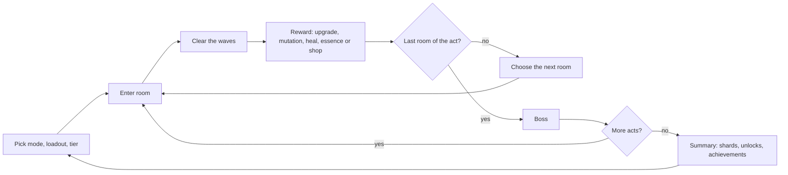
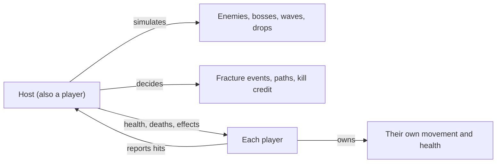

## rush-fracture
**break speed. survive chaos.**

a fast first-person roguelike built in godot 4.6. you fight through a living hive one arena at a time, building a different set of weapons, upgrades and mutations every run, alone or with friends. a companion go backend for stats exists but is optional and not yet called by the game.

---

## current state

playable end to end, solo and multiplayer:

- 5 run modes plus 10 difficulty tiers, co-op and two versus modes
- 8 weapons, 14 enemy types with 5 elite variants, 5 bosses
- 57 upgrades, 12 mutations, 9 fracture events
- 3 acts with their own look and music, 11 arena layouts with decks, ramps, jump pads, cover and hazards
- persistent progression: shards, 12 meta upgrades, weapon and perk unlocks, 7 skins, 12 achievements
- every sound and the soundtrack are generated at runtime; the game ships no audio files

it has been played heavily by an automated bot (see "testing"), not yet by a group of real players. treat the balance as a first pass. see "known limitations" before calling it launch-ready.

---

## the run



between rooms you usually choose where to go next: a harder room with a better reward, a shop, or a place to heal.

### modes

| mode | what it is |
|------|------------|
| standard | three acts, three bosses, branching paths |
| sprint | one act, one boss, about ten minutes |
| endless | acts keep coming and keep getting harder |
| boss rush | every boss back to back, with an armory stop between |
| daily | one seed per day, the same run for everyone |

**ascension** (tiers 1 to 10) makes enemies tougher and pays more shards. from tier 2 the fracture core waits after the titan; from tier 4 more enemies are elites.

---

## movement and combat

- dash with charges, slide, air control, and a ground slam when you press slide in the air
- jump pads and raised decks give every arena a vertical route
- weak points: hits to an enemy's exposed spot do extra damage
- kills in quick succession build a combo that makes you faster and stronger until it drops
- attacks are telegraphed on the floor before they land, so danger is readable at speed

### weapons

you carry three. three are free, five are unlocked with shards.

| weapon | role |
|--------|------|
| grafted carbine | accurate hitscan rifle |
| sporecaster | close range spread |
| stinger | continuous beam with heat |
| needle hive | embeds needles that burst |
| bile mortar | arcing explosive |
| marrow lance | charged piercing shot |
| synapse coil | lightning that chains between enemies |
| ripper | bouncing saw disc |

### build

- **upgrades** (57): common, rare, epic and cursed. some are plain stats, some change how a weapon works, some trigger on kills, dashes or slams. cursed ones are strong and cost you something.
- **mutations** (12): run-long rule changes with a real downside, such as glass cannon, blood pact, hollow bones or predator.
- **the tithe altar**: a shop room where essence dropped by enemies buys healing, max health and upgrades.

---

## the hive

### enemies

| enemy | behaviour |
|-------|-----------|
| broodling | tiny, arrives in swarms |
| ripper hound | fast melee rusher |
| swelling spore | runs at you and detonates |
| spore marksman | ranged, keeps its distance |
| bile spitter | lobs pools of acid |
| tendon leaper | jumps onto your position |
| blink fang | dashes in a line |
| ovipositor stalk | long range, locks on before it fires |
| sting drone | flies and strafes |
| choir spore | heals and hastens its allies |
| carapace bulwark | blocks shots from the front |
| phase wraith | teleports around you |
| brood hulk | slow, heavy, ground slam |
| brood mother | spawns broodlings until killed |

elites carry one of five traits: volatile, regenerating, swift, shielded or vampiric.

### bosses

| boss | where |
|------|-------|
| brood warden | act one |
| rift stalker | act two |
| hive matriarch | act two |
| fracture titan | final act |
| fracture core | after the titan, ascension 2 and up |

each has phases, a set of telegraphed attack patterns, and its own arena.

### rooms and events

room types: combat, swarm, elite, elite chamber, gauntlet, hazard, sanctuary, tithe altar and boss. the three acts (hatchery, marrow, fracture) each have their own palette, enemy strain and music key.

**fracture events** can break out mid-fight for a few seconds: velocity surge, unstable gravity, fracture echo, void drift, adrenaline leak, unstable field, perception fracture, blood frenzy, essence storm.

---

## multiplayer



ENet, listen server, join by room code (with an address field for another machine on the network). a host and up to four others.

- **co-op**: one shared run. enemies scale with the number of players, each player picks their own upgrades, and the run only ends when everyone is down in the same room.
- **race**: a short four-room gauntlet scored on kills, damage and rooms, ending in a duel in the last arena.
- **pvp encounter**: the same gauntlet, played for the duel.

the host owns every enemy. clients report their hits and take health, deaths and kill credit from the host, so everyone sees the same fight. there is no relay or NAT traversal yet: across the open internet the host has to forward a port.

---

## progression

saved locally, written atomically so a crash cannot corrupt it:

- fracture shards earned every run, more on higher ascension
- 12 meta upgrades bought with shards
- unlocks: five weapons, weapon variants, starting perks and skins, each with a requirement and a price
- 12 achievements that pay shards
- lifetime stats, daily best, settings and key bindings

---

## art and audio

one art direction, "grafted brood": a bio-mechanical organism grown over tech and architecture. every weapon, enemy, boss, prop and obstacle is a 3D model in `game-client/assets/models/`, generated from code in `concept-models/` (three.js builders exported to GLB).

sound is synthesised, not recorded. `sound_synth.gd` renders about sixty layered effects from small recipes at startup, and `music_synth.gd` renders an eight-bar loop per act as three layers (pad, drums and bass, lead) that fade in and out with the fight.

there is no game icon, custom font or marketing art yet.

---

## controls

| action | key |
|--------|-----|
| move | WASD |
| look | mouse |
| fire | left click |
| jump | space |
| dash | shift |
| slide, or slam in the air | ctrl or C |
| weapons | 1 / 2 / 3 or mouse wheel |
| interact | E |
| hide hud | F2 |
| pause | escape |

gamepad works too. settings open from the main menu or the pause menu: keys can be rebound, along with sensitivity, field of view, screen shake, hit-stop, damage numbers and hud scale.

---

## running the project

1. open `game-client/` in godot 4.6 or newer
2. run the project (the main scene is `scenes/main_menu.tscn`)
3. multiplayer: one player hosts and shares the room code, the others join with it

export presets are included for windows and macos. the `tests/` folder is excluded from exports.

### rebuilding the models

```bash
cd concept-models
npm install
node build-models.mjs
```

this writes the GLB files into `game-client/assets/models/`.

---

## testing

everything runs headless from the command line. `--path game-client` is assumed below.

| what | command |
|------|---------|
| unit tests | `godot --headless -s res://tests/run_unit.gd` |
| bot playtest | `godot --headless --fixed-fps 60 -s res://tests/run_smoke.gd -- --mode=sprint --runs=3` |
| two-player session | one copy with `-s res://tests/run_net.gd -- --role=host`, one with `--role=join` |
| two-player session through the menu | `-s res://tests/run_lobby.gd -- --role=host`, then `--role=join --code=<the code it prints>` |
| audio render check | `godot --headless -s res://tests/run_audio.gd -- --out=some/dir` |
| screenshots | `godot -s res://tests/run_shots.gd -- --out=some/dir` |

the bot plays real runs through the same input and menus a player uses: it aims, moves, dashes, slides, picks rewards, shops, chooses paths and restarts. options cover mode, seed, ascension, loadout, skill level and whether it can die. each script documents its own options at the top.

point `APPDATA` (or the platform equivalent) at a scratch directory when running these so they never touch a real save.

---

## backend (optional)

a stateless go service with a SQLite file. the game does not call it yet; it is ready for server-side stats or leaderboards.

```bash
cd backend
cp .env.example .env   # set a real API_KEY first
docker compose up --build -d
```

this builds the two-stage `Dockerfile` (CGO enabled for the sqlite driver), serves on port 8080 with a persistent volume, and checks `/health` on an interval. without docker, `go run ./cmd` works against a local file.

| method | path | purpose |
|--------|------|---------|
| GET | /health | liveness and db check |
| POST | /api/users | create a user |
| GET | /api/users/{id} | fetch a user |
| POST | /api/runs/start | start a run |
| POST | /api/runs/{id}/end | submit run results |
| GET | /api/runs/{id} | fetch a run |
| POST | /api/runs/{id}/rooms/enter | log a room entered |
| POST | /api/runs/{id}/rooms/clear | log a room cleared |
| POST | /api/runs/{id}/upgrade | log an upgrade choice |
| GET | /api/runs/{id}/events | a run's event log |
| GET | /api/stats/{userId} | aggregate stats for a user |
| GET | /ws | websocket hub (not used by anything yet) |

every route except `/health` requires an `X-API-Key` header when `API_KEY` is set, is rate limited per address and has a body size cap. that is a gate, not per-user authentication.

---

## how the code is laid out

```
rush-fracture/
  game-client/
    scenes/            main menu, the run scene, the player
    scripts/           game_manager.gd: wires the run together
    systems/
      core/            stats, damage, layers, shared registry, effects
      player/          movement, camera, input
      combat/          weapons, projectiles, damage, combo, game feel
      enemy/           base classes, 14 enemy types, 5 bosses
      rooms/           arena builder, layouts, biomes, waves, hazards, pickups
      run/             run structure, modes, difficulty
      upgrades/ mutations/ fracture/
      progression/     profile, shards, unlocks, achievements
      network/ modes/  sessions, spawning, versus rules
      audio/           effect and music synthesis
      ui/              hud, menus, panels
    tests/             bot, unit tests, network and audio checks
    assets/models/     generated GLB models
  concept-models/      the code that builds the models
  backend/             optional go service
```

a few rules the code follows:

- no autoloads. the run scene's systems register themselves in a small static registry (`Game`), and every lookup copes with a system being absent.
- every number that an upgrade can change is a `StatBlock` value with named modifiers, so effects stack and are removed exactly.
- all player damage goes through one function (`Combat.deal`), which is where crits, weak points, on-hit effects and kill credit are decided.
- enemies are built from a table of definitions, bosses from timed attack sequences.
- strict typing throughout, and signals between systems instead of polling.

---

## known limitations

- balance has only been tuned against a bot; no structured playtest with people yet
- sound is synthesised at runtime and has not been through real sound design
- no game icon, custom font or store assets
- multiplayer across the internet needs manual port forwarding; no relay, matchmaking or host migration
- no localisation, no colour-blind modes
- no linux export preset; windows and macos builds are unsigned
- the backend is not connected to the game

---

## notes

this started as a learning exercise and grew into a complete game. the goal was to build something real, learn godot and multiplayer networking along the way, and keep it enjoyable to work on.
